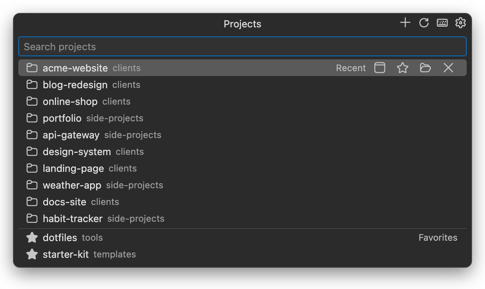
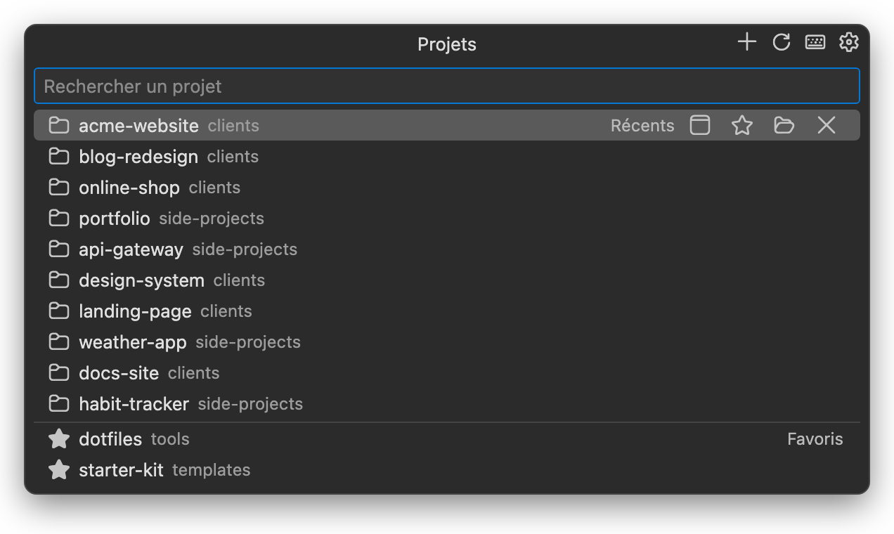

<p align="center">
	
</p>

<h1 align="center">Projects Quick Switch</h1>

<p align="center">
	<strong>A Visual Studio Code extension to switch between projects in a flash, PhpStorm style.</strong><br>
	A fast, keyboard-first alternative to project manager extensions.
</p>

<p align="center">
	<a href="https://marketplace.visualstudio.com/items?itemName=florian-lucas.projects-quick-switch"></a>
	<a href="https://github.com/lucasflorian/projects-quick-switch/releases/latest"></a>
	<a href="LICENSE.txt"></a>
</p>

<p align="center"><a href="#français">Version française plus bas</a></p>

<p align="center">
	
</p>

## Installation

- **From VS Code**: open the Extensions view (`⇧⌘X` / `Ctrl+Shift+X`), search for **Projects Quick Switch** and click *Install*.
- **From the [Visual Studio Marketplace](https://marketplace.visualstudio.com/items?itemName=florian-lucas.projects-quick-switch)**: click *Install*.
- **From the command line**: `code --install-extension florian-lucas.projects-quick-switch`
- **Offline**: download the `.vsix` from the [latest release](https://github.com/lucasflorian/projects-quick-switch/releases/latest), then `code --install-extension projects-quick-switch-<version>.vsix`.

## Features

- **Project picker** with the focus in the search field: recent projects first (most recently opened, across all windows), then favorites. Every other known project (auto-detected, older recent ones) shows up as soon as you type a search, or permanently with `projectSwitcher.showOtherProjects`.
- Each row shows the folder name and the path of its parent folder (configurable).
- **Enter or click** opens the project in a new window. If the project is already open, its window is brought to front. The current project is not listed, so pressing Enter right away takes you back to the previous one.
- **Row buttons**: open the other way (current or new window), add to or remove from favorites, reveal in Finder / File Explorer, remove from recent.
- **Auto-detected projects** in the folders of `projectSwitcher.scanFolders` (folders containing `.git`, `.idea`, `.vscode`, `composer.json` or `package.json`). Scanning is asynchronous and cached: the list shows up instantly.
- **Migration from Project Manager** (alefragnani): its projects are imported as favorites on first launch, with their names.
- English and French interface.

## Open the picker

- `⌥R` on macOS, `Alt+R` on Windows and Linux.
- The current project name, far left in the status bar.
- The extension icon in the editor tab bar.
- Command palette: `Projects: Switch Project`.

VS Code does not let extensions add items to the title bar: the editor tab bar and the status bar are the closest places.

### Change the shortcut

Run `Projects: Change Keyboard Shortcut` (or click the keyboard icon in the picker), then press the new key combination.

When the integrated terminal has the focus, the terminal receives the shortcut. To use it there too, add the command to `terminal.integrated.commandsToSkipShell`:

```json
"terminal.integrated.commandsToSkipShell": ["projectSwitcher.open"]
```

## Commands

- `Projects: Switch Project`
- `Projects: Add Current Project to Favorites` (also renames a favorite)
- `Projects: Add a Folder to Favorites…`
- `Projects: Import Projects from Project Manager`
- `Projects: Search Projects in Folders`
- `Projects: Change Keyboard Shortcut`

## Settings

| Setting | Default | Purpose |
| --- | --- | --- |
| `projectSwitcher.openInNewWindow` | `true` | Open in a new window (a new tab with `window.nativeTabs` on macOS). |
| `projectSwitcher.reuseEmptyWindow` | `true` | Use the current window when it is empty. |
| `projectSwitcher.pathDisplay` | `parentPath` | `parentPath` (parent path next to the name), `parentPathBelow` (below), `parentName` (parent name only), `parentNameBelow` (parent name below), `none`. |
| `projectSwitcher.recentLimit` | `10` | Size of the "Recent" section. |
| `projectSwitcher.showOtherProjects` | `false` | Also list the "Other Projects" section when the search field is empty. |
| `projectSwitcher.scanFolders` | `[]` | Folders to search for projects, e.g. `["~/Projects"]`. |
| `projectSwitcher.scanDepth` | `2` | Search depth. |
| `projectSwitcher.scanMarkers` | `.git`, `.idea`… | Files that identify a project. |
| `projectSwitcher.showInStatusBar` | `true` | Current project in the status bar. |
| `projectSwitcher.showInEditorTitle` | `true` | Button in the editor tab bar. |

**Tip (macOS):** set `"window.nativeTabs": true` to open new windows as tabs of the same window, like PhpStorm.

## Development

```bash
npm run package   # builds releases/projects-quick-switch-<version>.vsix with @vscode/vsce
code --install-extension releases/projects-quick-switch-<version>.vsix
```

The status bar icon comes from `media/icon-font.woff`, generated from `media/icon-outline.svg` by `scripts/build-icon-font.py` (instructions at the top of the script).

---

## Français

**Extension Visual Studio Code** pour passer d'un projet à l'autre en un éclair, façon PhpStorm. Une alternative rapide et pensée pour le clavier aux extensions de gestion de projets.

<p align="center">
	
</p>

### Installation

- **Depuis VS Code** : ouvrez la vue Extensions (`⇧⌘X` / `Ctrl+Shift+X`), cherchez **Projects Quick Switch** et cliquez sur *Install*.
- **Depuis le [Visual Studio Marketplace](https://marketplace.visualstudio.com/items?itemName=florian-lucas.projects-quick-switch)** : cliquez sur *Install*.
- **En ligne de commande** : `code --install-extension florian-lucas.projects-quick-switch`
- **Hors ligne** : téléchargez le `.vsix` de la [dernière release](https://github.com/lucasflorian/projects-quick-switch/releases/latest), puis `code --install-extension projects-quick-switch-<version>.vsix`.

### Fonctions

- **Sélecteur de projets** avec le focus dans le champ de recherche : projets récents en tête (ordre de dernière ouverture, toutes fenêtres confondues), puis favoris. Les autres projets connus (détectés, récents plus anciens) apparaissent dès que vous tapez une recherche, ou en permanence avec `projectSwitcher.showOtherProjects`.
- Chaque ligne affiche le nom du dossier et le chemin ou le nom de son dossier parent, à côté ou en dessous (réglable).
- **Entrée ou clic** ouvre le projet dans une nouvelle fenêtre. Si le projet est déjà ouvert, sa fenêtre passe au premier plan. Le projet actuel n'est pas proposé : Entrée ramène donc au projet précédent.
- **Boutons sur chaque ligne** : ouvrir dans l'autre mode (fenêtre actuelle ou nouvelle), ajouter aux favoris ou en retirer, afficher dans le Finder, retirer des récents.
- **Projets détectés automatiquement** dans les dossiers de `projectSwitcher.scanFolders` (dossiers contenant `.git`, `.idea`, `.vscode`, `composer.json` ou `package.json`).
- **Migration depuis Project Manager** : ses projets sont importés en favoris au premier lancement, avec leurs noms.
- Interface en français et en anglais, selon la langue de VS Code.

### Ouvrir le sélecteur

- `⌥R` sur macOS, `Alt+R` sur Windows et Linux.
- Le nom du projet actuel, tout à gauche de la barre d'état.
- L'icône de l'extension dans la barre des onglets.
- Palette de commandes : `Projets : Changer de projet`.

### Modifier le raccourci

Lancez `Projets : Modifier le raccourci clavier` (ou cliquez sur l'icône clavier du sélecteur), puis tapez la nouvelle combinaison.

Quand le terminal intégré a le focus, c'est lui qui reçoit le raccourci. Pour qu'il fonctionne aussi dans le terminal, ajoutez la commande à `terminal.integrated.commandsToSkipShell` (voir l'exemple plus haut).

**Astuce (macOS) :** avec `"window.nativeTabs": true`, les nouvelles fenêtres s'ouvrent en onglets dans la même fenêtre, comme dans PhpStorm.
